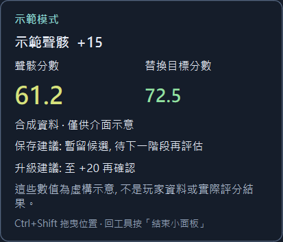

# 鳴潮本機助手 / Wuwa Personal Assistant

《鳴潮》**非官方社群工具**：在 Windows 本機辨識聲骸、比較分數與規劃養成。
使用 Python／PySide6、SQLite 與離線 OCR；不操作遊戲、不讀取遊戲程序或記憶體。
與 KURO GAMES 無隸屬、授權、贊助或合作關係。

[](https://github.com/CydemExsit/wuwa-personal-assistant-oss/actions/workflows/ci.yml)
[MIT](LICENSE) · [使用說明](docs/display-edition.md) · [問題回報](https://github.com/CydemExsit/wuwa-personal-assistant-oss/issues)

## 功能與支援

- 手動啟動後，被動辨識指定顯示器的支援聲骸頁面。
- 顯示聲骸分數、替換目標分數、保存／升級建議；低信心資料要求人工確認。
- 單螢幕使用工具自己的置頂小面板，雙螢幕使用完整工作區，可隨時切換。
- 管理角色養成、裝備位置、歷史、素材、待辦、抽卡規劃與本機備份。
- 角色使用文字縮寫；不散布遊戲圖片、活動圖片或私人 OCR 素材。

支援 **Windows 10 2004+／Windows 11 x64**，遊戲繁體中文、無邊框並填滿所選顯示器。
支援 1920×1080、2560×1440；不支援任意比例、黑邊、非滿螢幕或獨佔全螢幕。



圖中為虛構介面示意，不是玩家截圖或實際評分結果。

## 安裝與第一次使用

**一般使用者：[下載 Windows 安裝檔（1.1.2）](https://github.com/CydemExsit/wuwa-personal-assistant-oss/releases/download/v1.1.4/WuwaPersonalAssistant-OSS-1.1.4-Setup.exe)** · [其他下載與免安裝 ZIP](https://github.com/CydemExsit/wuwa-personal-assistant-oss/releases/latest)

1. 下載檔名結尾為 `-Setup.exe` 的安裝檔，雙擊後按「安裝」。
2. 安裝完成開啟程式，之後使用桌面或開始功能表的「鳴潮本機助手 OSS」捷徑。
3. 快速開始只有一頁：已依螢幕配置預選模式、遊戲螢幕與支援解析度；確認遊戲所在螢幕，按「測試這個螢幕」再「進入工具」。
4. 遊戲使用繁中、無邊框並填滿所選螢幕，開啟聲骸選擇清單；在「聲骸強化」按「啟動小面板」或「開始辨識」。

安裝不需要 Python、Git、PowerShell 指令或管理員權限；OCR 模型已包含，首次啟動不另行下載。
角色與評分模板可以稍後設定。單螢幕小面板按住 Ctrl+Shift 拖曳，回工具按「結束小面板」停止。
模式、螢幕與解析度可隨時在設定修改；擷取只會在你明確按下測試或開始後執行。

更新：工具開啟時會檢查正式新版，僅在工具內提示；也可到「設定 → 一般設定 → 程式更新」按「檢查新版」。
按「下載新版」後會比對正式 Release 的 SHA-256，完成後按「安裝並重新開啟」。
可關閉啟動檢查；不會自動下載或安裝，不會在工具關閉後執行。離線時仍能使用原版，也可選取收到的新版安裝檔。
更新會先停止辨識、完成已提交的保存、關閉資料庫，再安裝並重新開啟；安裝期間請勿關機。
安裝版沿用原位置；ZIP 版使用工具內更新時會轉為目前使用者的安裝版，資料位置不變。
尚未儲存的表單請先自行儲存。首次改用這個更新入口，需先安裝 1.1.4 或更新版本。可由 Windows「已安裝的應用程式」解除安裝；
更新與解除安裝均保留 `%LOCALAPPDATA%\WuwaDisplayAssistant` 的角色、歷史、設定與備份。
兩個版本使用不同安裝目錄與捷徑，但沿用原本相同的本機資料位置；使用其中一版前先關閉另一版。
免安裝 ZIP 仍可使用：完整解壓後執行 `WuwaDisplayAssistant.exe`，保留 `_internal`。
`ThirdPartySources`、`VerificationReports` 與 GitHub 的 `Source code` 是來源／驗證資料，一般使用者只需安裝檔。

封裝目前未簽章，Windows 可能顯示 SmartScreen 提示；請確認檔案來自本專案正式 Release，
不要停用防毒或 Windows 安全功能。同版 SHA-256 列於 `SHA256SUMS.txt`。
不支援的解析度或黑畫面會說明原因，不會猜測設定或自動更改 Windows／遊戲。

## 隱私、安全與限制

- 畫面只短暫存在記憶體，立即裁出允許的 ROI；不保存完整即時畫面、不上傳畫面、不使用雲端 OCR 或遙測。
- 角色、聲骸、歷史、設定與備份保存在本機。預設根目錄為 `%LOCALAPPDATA%\WuwaDisplayAssistant`。
- 公告／兌換碼等公開資料可聯網更新；辨識與評分不依賴雲端，不傳送玩家資料。
- 不模擬滑鼠／鍵盤／手把，不自動強化、選擇或棄置，不讀取遊戲檔案、記憶體或封包。
- 小面板是工具自己的 Qt 視窗並排除於自身擷取；禁止遊戲注入／附掛、DLL injection、graphics hook、程序附掛及戰鬥自動化。
- 分數是可檢視的養成比較模型，不是官方評分、傷害模擬或帳號安全保證；未知資料不猜成零。
- OCR 受字型、縮放、動畫及 UI 更新影響。1080p 已有 ROI／runtime 與縮放樣本驗證，仍需不同原生環境回饋。

本專案尚未宣稱外部使用者數、下載量或廣泛採用。早期開發在私人 repo 進行；此 repo
從清理後的 1.1.1 開始，不移植含私人作者資料及官方圖片的舊歷史。

## 開發與文件

```powershell
.\scripts\test.ps1
.\scripts\build.ps1 -SkipQualityChecks -OutputDirectory dist/releases/1.1.2
```

品質關卡包含完整測試、Ruff、格式、mypy、依賴與安全檢查。CI 另檢查可公開檔案、
歷史憑證與 Windows 封裝／啟動／離線 OCR。公開測試以合成資料為主；需要私人校準圖的
測試明確略過，私人資料不隨 repo 散布。

- [貢獻與可重現安裝](CONTRIBUTING.md)、[安全回報](SECURITY.md)、[變更記錄](CHANGELOG.md)
- [評分方法](docs/scoring-methodology.md)、[OCR 設計](docs/ocr-strategy.md)、[資料與備份](docs/data-management.md)
- [效能測量與範圍](docs/performance.md)、[歷史詳細說明](docs/user-guide.md)
- [第三方告知](THIRD_PARTY_NOTICES.md)、[依賴授權與對應來源](docs/dependency-licensing.md)

自有程式碼、文件與簡單圖形圖示採 [MIT](LICENSE)。函式庫、模型、遊戲商標及第三方內容
各有其權利，不因本專案的 MIT 授權而改變；分享成品時請保留第三方告知。

## English overview

An unofficial local-first Wuthering Waves desktop assistant for Windows x64,
with offline Echo OCR/scoring, replacement comparisons, planning, local history
and backups, and single/dual-monitor modes. Game UI support is Traditional Chinese
at1080p/1440p in a borderless full-monitor window. The passive panel is a separate
application window: no game injection, hooks, input automation, memory access,
telemetry or screenshot uploads. Game artwork and private samples are excluded.
See the installer link above, [contributing](CONTRIBUTING.md), [security](SECURITY.md)
and the [MIT license](LICENSE). This is an early public project; external adoption
has not been established.
